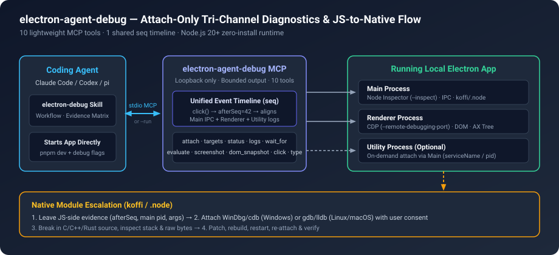
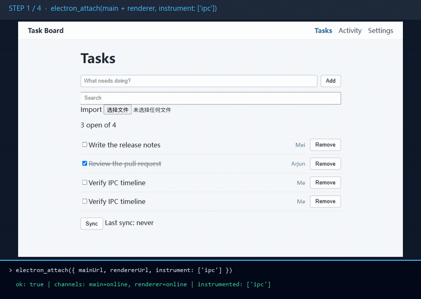

# electron-agent-debug

**English** | [简体中文](README.zh-CN.md)

> Attach-only runtime diagnostics for Electron apps, as a lightweight MCP server (10 tools) plus an [Agent Skill](https://agentskills.io). Read main, renderer, and utility process logs on **one unified `seq` timeline**, evaluate code, take screenshots and accessibility snapshots, click and type in the real window — and when a native call (`koffi`, `.node`) misbehaves, trace straight from JS into WinDbg/cdb, gdb, or lldb. Node.js 20+, zero install step for the runtime.



### Live Demo (Real Electron App)

Attached to `examples/vue-vite-app` with `instrument: ["ipc"]` → typed `"Verify IPC timeline"` via `electron_type` → clicked **Add** via `electron_click` → waited for Main-process IPC log via `electron_wait_for` → navigated to **Activity** and captured screenshots:



## Why This Exists

Existing approaches for letting coding agents debug Electron apps fall into two extremes:

- **Renderer-only browser MCPs** (e.g., `chrome-devtools-mcp`, Playwright): blind to the Main process (Node Inspector) and utility processes — they cannot diagnose window creation failures, preload/contextBridge issues, or bidirectional IPC. Splitting main and renderer into two separate MCPs breaks timeline alignment.
- **All-in-one Electron debuggers**: expose 50–100+ tools and try to own app startup/shutdown, bloating model context and breaking on complex dev toolchains (`electron-vite`, Forge, monorepos).

**`electron-agent-debug` takes a focused middle ground:**

1. **Tri-Channel + Unified `seq` Timeline**: Main Inspector, Renderer CDP, and optional Utility Process share one monotonic event sequence. One `electron_click` returns an `afterSeq` that filters both Main IPC logs and Renderer errors simultaneously.
2. **Attach-Only, Zero Lifecycle Magic**: Your agent starts the app using your project's own command (`pnpm dev`, `electron-vite`, etc.). The MCP stays project-agnostic, ships with 3 runtime dependencies, and runs via Node.js 20+ with no build step.
3. **JS-to-Native Debugging Loop**: When a `koffi` or `.node` native function returns the wrong result, the Skill captures JS-side evidence first, then guides an external debugger (WinDbg/cdb on Windows, gdb/lldb on Linux and macOS) with user consent to set source breakpoints, inspect raw bytes/variables, patch, rebuild, and re-verify.
4. **Structured Evidence, Not Guesswork**: Bounded, structured runtime facts from MCP + an explicit evidence matrix in the Skill so the agent reports `PASS`, `FAIL`, or `BLOCKED` backed by real execution.

## MCP Tools (10 Total)

| Category | Tools | Purpose |
| --- | --- | --- |
| Connect | `electron_attach`, `electron_targets` | Attach to main / renderer / utility channels; pick windows (DevTools auto-excluded) |
| Observe | `electron_status`, `electron_logs`, `electron_wait_for` | Inspect channel/dialog status, read unified `seq`-indexed logs, wait for log or expression signals |
| Inspect | `electron_evaluate`, `electron_screenshot`, `electron_dom_snapshot` | Evaluate JS in target scope, capture PNG screenshots, dump accessibility tree with `[ref=…]` |
| Interact | `electron_click`, `electron_type` | Click or type in the real window by accessibility `[ref=…]` or `role` + `name` |

- `electron_evaluate` and expression-based `electron_wait_for` are enabled by default; set `ELECTRON_DEBUG_ALLOW_EVAL=0` in the host MCP `env` to disable evaluation, interaction, utility attach, and instrumentation.
- Screenshots are written to `ELECTRON_DEBUG_OUTPUT_DIR` (defaults to OS temp dir, keeps latest 50).
- To inspect a **utility process**, pass `utility` (`serviceName` or `pid`) to `electron_attach` while the main channel is online and eval is allowed (uses `process._debugProcess`; pass `--inspect-port=<free-port>` in `execArgv` if port 9229 is busy).

## Common Scenarios & Native Case Study

- Verify main-process startup, `BrowserWindow` creation, crashes, and exit reasons.
- Debug `preload`, `contextBridge`, and IPC end-to-end (pass `instrument: ["ipc"]` to trace `IPC invoke <channel>` on the shared timeline).
- Diagnose blank windows, frontend runtime errors, and actual rendered UI via screenshots + accessibility snapshots.
- Trace misbehaving native modules (`koffi`, `.node`) from JS into C/C++/Rust source breakpoints — see [native.md](skill/electron-debug/references/native.md) and the full walkthrough in [Case Study: From JS Call to C++ Breakpoint](docs/case-study-native-debugging.md).

### Quick Example: Catching a Bug Inside a `koffi` Native Function

A native function `sum_sizes` (recursive directory size) returned `30` instead of `100` (verified end-to-end on Windows):

1. Reproduced via `electron_evaluate` (main scope) → confirmed `30` and captured main `pid` + `afterSeq`.
2. With user consent, attached `mcp-windbg` (`cdb`) to the main process and set 3 source-line breakpoints in the loop.
3. Triggered the call: recursion hit once instead of three times and stopped on a stray `break;` that exited after the first subdirectory.
4. Removed `break;`, stopped the app before rebuilding (avoiding `LNK1168`), restarted, re-attached, and verified `100`.

## Installation & Setup

The Skill package bundles the built MCP server (`runtime/server.cjs`), integrity launcher (`runtime/launch.cjs`), manifest, and licenses. **Only Node.js 20+ is required** — no `npm install` or build step.

### Option 1: Agent Skills CLI (Recommended)

```bash
# Project-level
npx skills add longhun12346/electron-agent-debug --skill electron-debug

# Global (shared across projects)
npx skills add longhun12346/electron-agent-debug --skill electron-debug --global
```

Installing the Skill does not auto-register the MCP server. Your agent verifies integrity via `node <skill-dir>/runtime/launch.cjs --verify` and asks your consent before registering MCP. Until reload (or without MCP registration), it can run one-shot batches via `launch.cjs --run` (see [MCP Setup](skill/electron-debug/references/mcp-setup.md)).

### Option 2: Claude Code Plugin (Skill + MCP in One Step)

```text
/plugin marketplace add longhun12346/electron-agent-debug
/plugin install electron-debug@electron-agent-debug
```

On Claude Code 2.1.275+: `/plugin install electron-debug --marketplace longhun12346/electron-agent-debug` (run `/reload-plugins` when prompted).

<details>
<summary>Other Hosts (Codex, pi, DeepSeek Harness)</summary>

Copy the full `skill/electron-debug/` directory (including `runtime/` and `references/`) into:

| Host | Project-level | Global |
| --- | --- | --- |
| Claude Code | `.claude/skills/` | `~/.claude/skills/` |
| Codex, pi | `.agents/skills/` | `~/.agents/skills/` |
| DeepSeek Harness (dsh) | `.dsh/skills/` or `.agents/skills/` | `~/.dsh/skills/` or `~/.agents/skills/` |

Register MCP (with user consent):
- Codex: `codex mcp add electron-agent-debug -- node <skill-dir>/runtime/launch.cjs`
- pi: `pi mcp add electron-agent-debug --exposure direct -- node <skill-dir>/runtime/launch.cjs`
- dsh: see [MCP Setup](skill/electron-debug/references/mcp-setup.md).

</details>

### Launch Flags Cheat Sheet

Start your Electron app with debug ports (`<I>` for main, `<R>` for renderer):

| Setup | Command |
| --- | --- |
| `electron .` / built app | `electron . --inspect=<I> --remote-debugging-port=<R>` |
| `electron-vite` | `electron-vite dev --inspect <I> --remoteDebuggingPort <R>` (or env `V8_INSPECTOR_PORT=<I>` `REMOTE_DEBUGGING_PORT=<R>`) |
| `Electron Forge` | `electron-forge start --inspect-electron -- --remote-debugging-port=<R>` |

More setups (`vite-plugin-electron`, monorepo turbo) in [launch.md](skill/electron-debug/references/launch.md).

### Reliable Skill Triggering

Add one line to your Electron project's `CLAUDE.md` or `AGENTS.md`:

```markdown
When changing Electron main process, preload, or IPC, or investigating a blank window, crash, or runtime error, use the electron-debug skill to attach to the running app and verify instead of guessing from code.
```

## Boundaries & Platform Support

- **Platform verification**: The MCP runtime is smoke-tested in CI on Windows, macOS, and Linux. Native debugging is verified on Windows (`mcp-windbg` + `cdb`) and Linux (`gdb`/`lldb`), and on macOS only on a GitHub arm64 runner (`lldb`).
- **Loopback only**: Allows `127.0.0.1`, `::1`, and `localhost` only. Not for packaged apps or remote endpoints.
- **Non-invasive by default**: Does not start/stop/restart your app; attaches without injecting code unless `instrument: ["ipc" | "dialogs"]` is explicitly passed.
- **No redaction**: Outputs are size-bounded but **not redacted** (logs, eval results, titles, URLs may contain tokens/cookies). Use only on local dev apps without real production credentials.
- **Out of scope**: General desktop automation (drag, hover, shortcuts), network recording, profiling/heap snapshots, JS source breakpoints, and native dialog/menu mocks. Hidden/minimized windows cannot be screenshotted.

## Documentation

- [Chinese README (简体中文)](README.zh-CN.md)
- [Case Study: From JS Call to C++ Breakpoint](docs/case-study-native-debugging.md)
- [Requirements](docs/requirements.md) · [Architecture](docs/architecture.md) · [Community Comparison](docs/community-comparison.md)
- [Agent Skill](skill/electron-debug/SKILL.md) · [Contributing](CONTRIBUTING.md)

## Local Development

```bash
npm install
npm test
npm run lint
```

Real Electron examples: [examples/vue-vite-app](examples/vue-vite-app/README.md) and [examples/native-eval](examples/native-eval/README.md).
