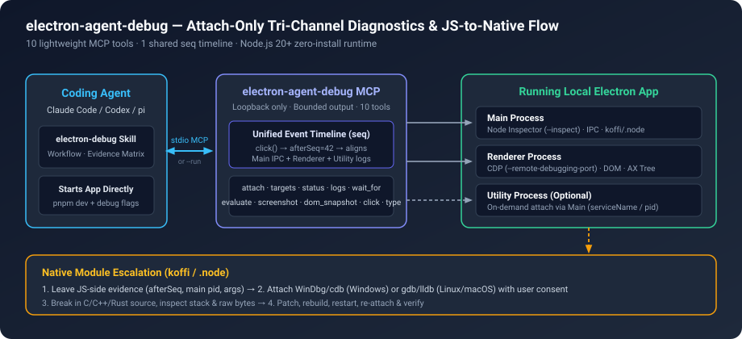
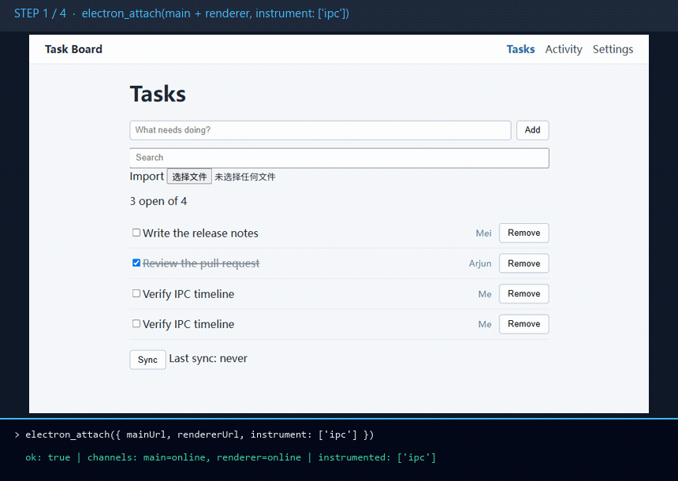

# electron-agent-debug

[English](README.md) | **简体中文**

> 面向编码 Agent 的 Electron 运行时取证 MCP Server 与 [Agent Skill](https://agentskills.io)。用极简的 10 个工具，在一条统一时间线上同时观察主进程、renderer 与 utility process；遇到 `koffi` / `.node` 原生模块问题时，从 JS 调用一路跟到外部调试器（Windows 用 WinDbg/cdb，Linux/macOS 用 gdb/lldb）的原生源码断点。只需 Node.js 20+，运行时零安装。



### 实机演示（真实 Electron 应用）

连接 `examples/vue-vite-app`（开启 `instrument: ["ipc"]`）→ 通过 `electron_type` 输入 `"Verify IPC timeline"` → `electron_click` 点击 **Add** → `electron_wait_for` 等待主进程 IPC 日志 → 切换到 **Activity** 页面并截取全过程画面：



## 为什么做这个项目

社区里让 Agent 调 Electron 的常见做法分为两类，各有明显短板：

- **只连 renderer 的浏览器工具**（如 `chrome-devtools-mcp`、Playwright）：看不到主进程（Node Inspector）和 utility process，无法诊断窗口创建失败、preload 注入、IPC 双向链路和主进程异常；若把主进程拆到另一个 MCP，两侧日志失去统一时间线，Agent 难以对齐因果。
- **大而全的通用 Electron 调试器**：往往暴露几十上百个工具并接管应用启停，既撑爆模型上下文，又容易在复杂脚手架（electron-vite、Forge、monorepo）的启动环节失效。

本项目的核心取舍：

1. **三通道 + 统一 `seq` 时间线**：主进程 Inspector、renderer CDP、可选 utility process 共享同一条事件序列；一次点击或输入返回的 `afterSeq`，可同时过滤主进程 IPC 与 renderer 日志。
2. **只 Attach，不接管生命周期**：应用启动、热更新与重启交给 Agent 用项目已有命令完成，MCP 保持零项目专属逻辑、极简依赖（仅 10 个工具，Node.js 20+ 零安装运行）。
3. **JS 到原生模块的调试闭环**：遇到 `koffi` / `.node` 返回值不对时，先用本工具留下 JS 侧证据，再经用户同意接上外部调试器下断点对照原生源码定位。
4. **结构化证据而非替你拍板**：MCP 返回有界、结构化的运行时事实，Skill 规定取证顺序与证据矩阵，最终的 `PASS` / `FAIL` / `BLOCKED` 结论由 Agent 结合业务回归完成。

## MCP 工具（共 10 个）

| 类别 | 工具 | 说明 |
| --- | --- | --- |
| 连接 | `electron_attach`、`electron_targets` | 连接主进程/renderer/utility 通道；选择多窗口 target（自动排除 DevTools） |
| 观察 | `electron_status`、`electron_logs`、`electron_wait_for` | 查看通道与对话框状态、按 `seq` 游标读统一日志、等待日志或表达式信号 |
| 检查 | `electron_evaluate`、`electron_screenshot`、`electron_dom_snapshot` | 在对应进程求值、保存窗口截图、获取带 `[ref=…]` 的无障碍树快照 |
| 交互 | `electron_click`、`electron_type` | 按快照里的 `[ref=…]`（或 `role` + `name`）在真实窗口中点击和输入 |

- `electron_evaluate` 和表达式型 `electron_wait_for` 默认开启；宿主可在 MCP 配置的 `env` 中设 `ELECTRON_DEBUG_ALLOW_EVAL=0` 全关（求值、点击输入、utility、IPC/对话框追踪会一并禁用）。
- 截图保存到 `ELECTRON_DEBUG_OUTPUT_DIR`（默认系统临时目录，保留最近 50 张）。
- 需要调试 utility process 时，给 `electron_attach` 传 `utility`（`serviceName` 或 `pid`），通过已连接的主进程按需打开第三通道（依赖未公开接口 `process._debugProcess`，需主进程在线且允许求值；默认端口 9229 被占用时在 fork 的 `execArgv` 加 `--inspect-port=<空闲端口>`）。

## 适用场景与实战案例

- 主进程启动失败、窗口创建、崩溃和退出原因验证。
- preload、contextBridge 和 IPC 双向联调（传 `instrument: ["ipc"]` 可在时间线中直接等待 `IPC invoke <通道>`）。
- 页面白屏、前端异常、target URL 与页面实际内容验证（截图 + 无障碍树）。
- 原生模块（`koffi`、`.node`）函数返回值不对时，留下 JS 侧证据后经用户同意接上外部调试器，从 JS 调用跟到原生源码（详见 [native.md](skill/electron-debug/references/native.md) 与 [实战复盘：从 JS 调用一路调试到 C++ 原生断点](docs/case-study-native-debugging.md)）。

### 示例：定位原生函数的错误结果

一个用 `koffi` 调用的原生函数 `sum_sizes`（递归统计目录大小），应用里得到 30，预期 100（在 Windows 上实测走通）：

1. 用 `electron_evaluate`（main）复现：对测试目录求和得到 30。
2. 经用户同意，用 `mcp-windbg` 附加主进程，在循环里下三处源码行断点。
3. 触发调用后，递归那一行预期命中三次，实际只命中一次，随后停在多写的 `break;` 上：循环在第一个子目录之后提前退出。
4. 删掉 `break;`，先停应用再重新构建（否则链接会报 `LNK1168`），重启后得到 100。

## 安装与接入

Skill 发布包已内含构建好的 MCP 运行文件（`runtime/server.cjs`）、完整性启动器（`runtime/launch.cjs`）、版本清单和许可证，正常使用只需 **Node.js 20+**，无需下载源码、安装依赖或构建。

### 方式一：通过 Agent Skills CLI 安装（推荐）

```powershell
# 项目级安装
npx skills add longhun12346/electron-agent-debug --skill electron-debug

# 全局安装（多项目复用）
npx skills add longhun12346/electron-agent-debug --skill electron-debug --global
```

安装不会自动注册 MCP：Agent 会先执行 `node <absolute-skill-directory>/runtime/launch.cjs --verify` 校验完整性，经你同意后再注册为宿主 MCP；在重载生效前（或不注册 MCP 时），可直接使用 `launch.cjs --run` 批处理模式（详见 [MCP 接入说明](skill/electron-debug/references/mcp-setup.md)）。

### 方式二：作为 Claude Code 插件安装（一键含 MCP）

```text
/plugin marketplace add longhun12346/electron-agent-debug
/plugin install electron-debug@electron-agent-debug
```

Claude Code 2.1.275+ 也可一步完成：`/plugin install electron-debug --marketplace longhun12346/electron-agent-debug`（提示重载时运行 `/reload-plugins`）。

<details>
<summary>其他宿主（Codex、pi、DeepSeek Harness）目录与注册命令</summary>

手动复制完整 `skill/electron-debug/` 目录时的放置路径：

| 宿主 | 项目级 | 全局 |
| --- | --- | --- |
| Claude Code | `.claude/skills/` | `~/.claude/skills/` |
| Codex、pi | `.agents/skills/` | `~/.agents/skills/` |
| DeepSeek Harness（dsh） | `.dsh/skills/` 或 `.agents/skills/` | `~/.dsh/skills/` 或 `~/.agents/skills/` |

MCP 注册命令（Agent 会先征求同意；Codex、pi、dsh 部分仅依据官方文档，未实测）：
- Codex：`codex mcp add electron-agent-debug -- node <Skill 目录>/runtime/launch.cjs`
- pi：`pi mcp add electron-agent-debug --exposure direct -- node <Skill 目录>/runtime/launch.cjs`
- dsh 写法及完整说明见 [MCP 接入说明](skill/electron-debug/references/mcp-setup.md)。

</details>

### 常见脚手架启动参数速查

MCP 只 attach，不启动应用。带调试端口启动 Electron（`<I>`、`<R>` 为自选空闲端口）：

| 启动方式 | 命令 |
| --- | --- |
| `electron .` / 构建产物 | `electron . --inspect=<I> --remote-debugging-port=<R>` |
| `electron-vite` | `electron-vite dev --inspect <I> --remoteDebuggingPort <R>`（或设环境变量 `V8_INSPECTOR_PORT=<I>`、`REMOTE_DEBUGGING_PORT=<R>`） |
| `Electron Forge` | `electron-forge start --inspect-electron -- --remote-debugging-port=<R>` |

更多脚手架（如 `vite-plugin-electron`、monorepo turbo）见 [启动参数说明](skill/electron-debug/references/launch.md)。

### 让宿主稳定触发这个 Skill

在 Electron 项目的 `CLAUDE.md` 或 `AGENTS.md` 中加上一句，比单纯依赖描述匹配更稳定：

```markdown
改动 Electron 主进程、preload、IPC，或遇到白屏、崩溃、运行时报错时，用 electron-debug Skill 连接正在运行的应用来验证，不要只读代码推断。
```

## 设计边界与平台支持

- **平台验证**：MCP 运行时在 Windows、macOS、Linux 上均通过真实 Electron 冒烟测试；原生模块调试在 Windows（mcp-windbg + cdb）和 Linux（gdb/lldb）上实测通过，macOS 目前仅在 GitHub arm64 runner 上验证过 lldb 命令行。
- **仅限本地回环**：只允许 `127.0.0.1`、`::1` 或 `localhost`，不适用于打包后应用或远程地址。
- **不侵入应用**：不启动/停止/重启应用；attach 默认不往应用里装任何东西，仅当传 `instrument`（`["ipc"]` 或 `["dialogs"]`）时才在主进程装记录包装。
- **不做脱敏**：输出有大小上限但**不做脱敏**，日志、报错、求值结果、页面文本、地址和标题可能带出令牌、密码、cookie。只连接本地开发环境的应用，不要连接带真实生产凭据的应用。
- **能力边界**：不提供拖拽、悬停、快捷键等通用桌面自动化，也不提供网络录制、性能分析、heap snapshot、JS 源码级断点或原生对话框/菜单替身；窗口隐藏或最小化时无法截图。

## 项目文档

- [需求说明](docs/requirements.md) · [架构设计](docs/architecture.md) · [社区方案对比](docs/community-comparison.md)
- [实施方案与调研结论](docs/plan.md) · [接入说明](docs/integration.md) · [实战复盘：JS 到 C++ 原生调试](docs/case-study-native-debugging.md)
- [Agent 调试 Skill](skill/electron-debug/SKILL.md) · [开发说明](CONTRIBUTING.md)

## 本地开发

```powershell
npm install
npm test
npm run lint
```

真实 Electron 示例见 [examples/vue-vite-app/README.md](examples/vue-vite-app/README.md) 与 [examples/native-eval/README.md](examples/native-eval/README.md)。
